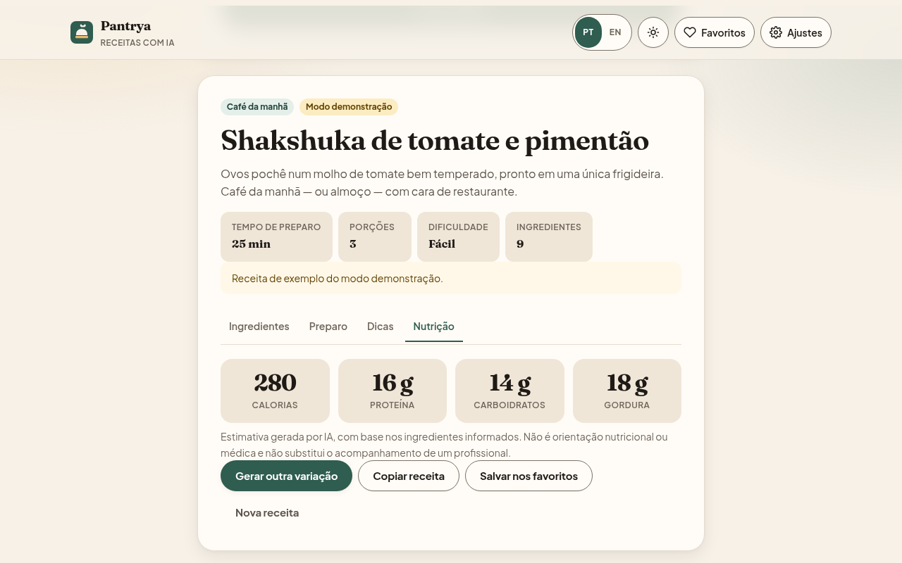
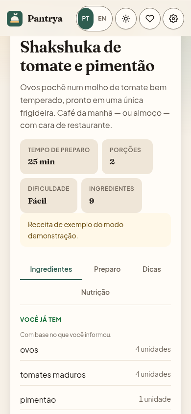
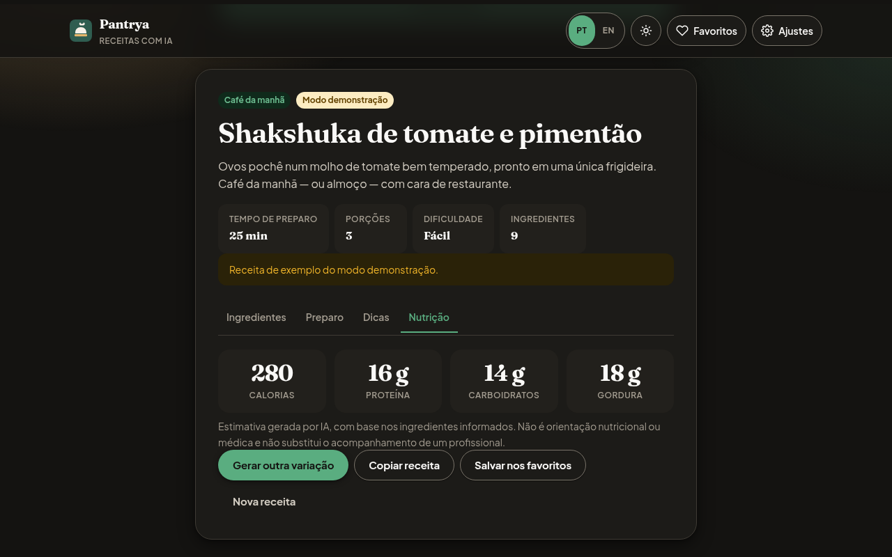

# Pantrya

Gerador de receitas com IA a partir dos ingredientes que você já tem.

A pessoa informa o que está na geladeira, escolhe tipo de refeição, tempo de preparo, restrição alimentar e número de porções, e o app devolve uma receita completa: o que já há em casa, o que falta comprar, o modo de preparo, dicas e uma estimativa nutricional.

Pantrya é um projeto de portfólio de Davi Silva: uma aplicação web estática, sem backend, pensada para GitHub Pages. A chamada à API da OpenAI (modelo `gpt-4o-mini`) sai direto do navegador, com a chave do próprio usuário. Há também modo demonstração, interface em português e inglês, e tema claro ou escuro.

**Demo (placeholder):** `https://<usuario>.github.io/<repositorio>/` — troque `<usuario>` e `<repositorio>` pelos seus após publicar no GitHub Pages.







## Destaques técnicos

- **Prompt engineering.** O modelo recebe os ingredientes e os filtros do usuário com instruções explícitas para montar a receita dentro de um contrato fixo, incluindo a separação entre o que já está disponível e o que precisa ser comprado.
- **Saída JSON estruturada.** A resposta é pedida via `response_format: json_object`, para a interface renderizar seções previsíveis em vez de interpretar texto livre.
- **Sem backend.** Não há servidor próprio nem proxy. O navegador fala com a API da OpenAI. O app pode ser servido como site estático (GitHub Pages ou qualquer servidor de arquivos).
- **Estado local.** A chave da OpenAI, o idioma, o tema e as receitas favoritas ficam no `localStorage` do navegador. Nada disso é enviado a um servidor do projeto.
- **Modo demonstração.** Há 12 receitas de exemplo, em português e inglês, que cobrem café da manhã, almoço, jantar, lanche e sobremesa, vários tempos de preparo e dietas (vegetariano, vegano, sem glúten, entre outras). O app escolhe pela combinação de ingredientes e filtros; se nenhuma receita bater em todos os filtros, mostra a mais próxima e avisa.

## Funcionalidades

- Entrada de ingredientes em chips, com sugestões e opção de limpar a lista
- Filtros em controles segmentados:
  - Tipo de refeição: Qualquer, Café da manhã, Almoço, Jantar, Lanche, Sobremesa
  - Tempo de preparo: Qualquer, Até 15 / 30 / 45 minutos, Até 1 hora, Mais de 1 hora
  - Restrição alimentar: Nenhuma, Vegetariano, Vegano, Sem glúten, Sem lactose, Sem frutos do mar
  - Porções de 1 a 8 (padrão 2)
- Receita em abas: Ingredientes (você já tem / falta comprar), Modo de preparo (passos com checkbox), Dicas e Nutrição (estimativa)
- Gerar outra variação, copiar a receita, salvar ou remover favoritos neste navegador
- Modo demonstração, com 12 receitas de exemplo que respeitam tipo de refeição, tempo e restrição quando há candidatas
- Uso com chave própria da OpenAI, guardada apenas no navegador
- Interface em português (padrão) com alternância para inglês
- Tema claro e escuro (`prefers-color-scheme` e um toggle que grava a preferência)

## Como rodar

Não há etapa de build nem variáveis de ambiente no servidor. Qualquer servidor HTTP estático basta. O app também funciona se você abrir o `index.html` pela URL `file://`; para publicar, use um servidor. As fontes tipográficas são carregadas do Google Fonts quando há rede; sem rede, o navegador cai nas fontes do sistema.

Com Python 3:

```bash
python3 -m http.server 8080
```

Com Node.js:

```bash
npx --yes serve .
```

Em seguida, abra `http://localhost:8080`.

Para publicar no GitHub Pages:

1. Crie um repositório público e envie esta pasta (`git remote add origin …` e `git push -u origin main`).
2. Em **Settings → Pages**, escolha **Deploy from a branch**, branch `main`, pasta `/ (root)`.
3. A URL segue o padrão `https://<usuario>.github.io/<repositorio>/` (troque `<usuario>` e `<repositorio>` pelos seus — é um placeholder até o repositório ser publicado).

Os caminhos de CSS, JS, favicon e imagem Open Graph são relativos (`style.css`, `app.js`, `favicon.svg`, `docs/og.png`), para funcionar na raiz de um projeto Pages. Há também um `404.html` com o mesmo visual. Depois de publicar, troque o `og:image` do `index.html` pela URL absoluta `https://<usuario>.github.io/<repositorio>/docs/og.png` se quiser que o cartão social resolva em todos os crawlers.

Para gerar receitas reais, crie uma chave de API em [platform.openai.com](https://platform.openai.com/api-keys), desligue o modo demonstração em Ajustes e cole a chave no app. O modelo usado é `gpt-4o-mini`. O uso é cobrado na conta da OpenAI do usuário.

## Chave da API e privacidade

A chave permanece somente no `localStorage` deste navegador. As requisições vão do cliente para a OpenAI; este repositório não inclui um backend que receba, encaminhe ou armazene a chave. (As fontes do Google Fonts são o único pedido de rede fora da API, e não recebem a chave.) Não use o app com a sua chave em um computador compartilhado. Remova a chave pelo próprio app quando terminar.

Se você já tinha usado uma versão anterior do app com o nome PantryChef, as chaves `pantrychef_*` do `localStorage` são copiadas uma vez para `pantrya_*` e em seguida removidas.

## Nutrição

Os valores nutricionais são uma estimativa gerada por IA, com base nos ingredientes informados. Não constituem orientação nutricional ou médica e não substituem o acompanhamento de um profissional.

## Estrutura do projeto

```
gerador-receitas-ia/
├── index.html
├── style.css
├── app.js
├── favicon.svg
├── 404.html
├── docs/
│   ├── screenshot-desktop.png
│   ├── screenshot-mobile.png
│   ├── screenshot-dark.png
│   └── og.png
├── README.md
├── LICENSE
└── .gitignore
```

## Próximos passos

Ideias em aberto, ainda não implementadas:

- Exportar a lista do que falta comprar
- Instalar como PWA, para uso offline da interface e dos favoritos (a geração continua exigindo rede e, no modo ao vivo, uma chave válida)
- Imagem do prato gerada por IA, junto do card
- Backend pequeno só para esconder a chave, se o app deixar de ser apenas um demo de portfólio

## Licença

MIT © Davi Silva

---

## English

Pantrya is a static, client-side recipe generator. You enter the ingredients you already have, set meal type, prep time, dietary restriction, and servings, and the app returns a full recipe: what you already have, what to buy, step-by-step instructions (with checkboxes), tips, and an AI-generated nutrition estimate. The interface is available in Portuguese and English, with light and dark themes.

It is a portfolio project by Davi Silva, built to run on GitHub Pages with no backend. The browser calls OpenAI (`gpt-4o-mini`) directly with the user’s own API key. The key, language, theme, and favorite recipes are stored in `localStorage` only. A demonstration mode includes 12 sample recipes (breakfast through dessert, several cook times, and vegetarian, vegan and gluten-free options). The app matches ingredients and filters; if nothing fits all of them, it shows the closest recipe and says so.

Technical notes: the model is steered with an explicit prompt and returns structured JSON through `response_format` with `json_object`, so the UI can render stable sections instead of parsing free text.

It also runs if you open `index.html` via `file://`; to publish it, use a static server, for example `python3 -m http.server 8080` or `npx --yes serve .`, then open `http://localhost:8080`. Typefaces load from Google Fonts when a network is available. A live demo, once published, will be at `https://<usuario>.github.io/<repositorio>/` (replace the `<usuario>` and `<repositorio>` placeholders with yours). Nutrition figures are AI estimates, not medical or dietary advice. API usage is billed to the user’s OpenAI account; do not paste a key on a shared computer.
